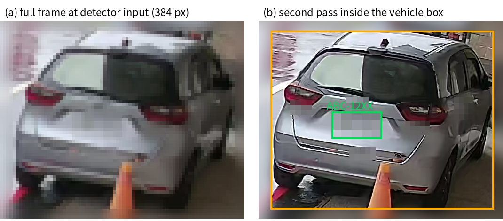
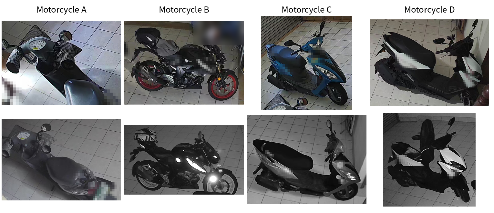
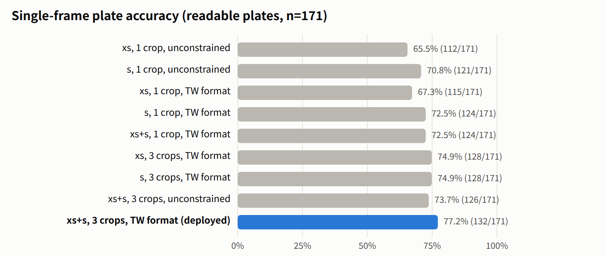
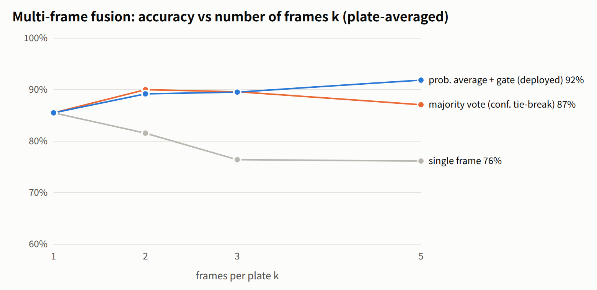
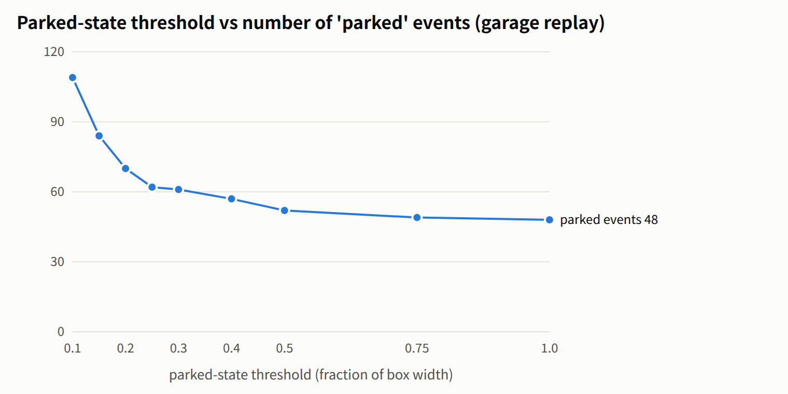
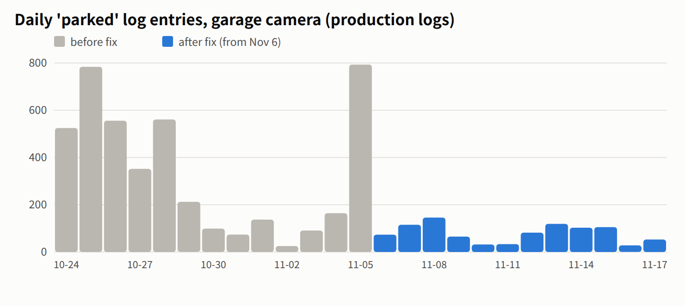
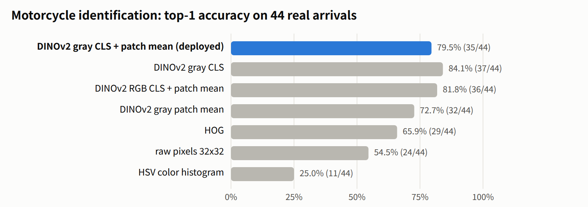

# A CPU-Only Residential License Plate Recognition and Vehicle Identification System: Multi-Frame Fusion, Taiwan Format-Constrained Decoding and Self-Supervised Appearance Matching — An Empirical Study

henry0411 · November 2026

---

## Abstract

This paper describes a license plate recognition and vehicle identification system deployed at a private home. It runs on one virtual machine with 4 vCPUs, 4 GB of RAM and no GPU, and serves an outdoor pan-tilt camera and an indoor garage camera.

Plate detection and OCR use public pre-trained models. On top of them we add a second plate-detection pass inside vehicle boxes, probability averaging over two OCR models and three crops, decoding constrained to Taiwanese plate formats, cross-frame probability fusion, and likelihood-based whitelist matching. On the vehicle side we add parked-state hysteresis, before/after edge-similarity verification of arrivals, and DINOv2 self-supervised features that identify the household's motorcycles when no plate is visible.

All evaluation data come from deployment logs: 350 plate detections (171 of them readable), 379 motorcycle crops and 44 real motorcycle arrivals. An AI assistant labelled them without seeing the system's output. We ran ablations and compared the combined pipeline with single-model, single-step baselines. The main results, with 95% confidence intervals, are:

**Three key results**

- **Appearance identification:** across all 44 motorcycle arrivals the system named a vehicle 26 times, and **24 of those names were correct (92.3%, [75.9%, 97.9%])**. On the 28 later arrivals, all 14 named vehicles were correct ([78.5%, 100%]), with or without the five added references; the added references raised **top-1 accuracy from 89.3% to 96.4% (27/28, [82.3%, 99.4%])**. The other arrivals were reported as "a motorcycle arrived".
- **Multi-frame fusion:** fusing five readable frames of the same plate gives **91.8% accuracy** (13 plates; plate-level bootstrap interval [82.0%, 100%]). On the same draws, a single frame gives 76.2% and a majority vote with a confidence tie-break 87.1%; fusing three frames gives 89.5% (25 plates). This measures decoding accuracy only, not the confirmation rule.
- **Whitelist matching:** **all 56 non-whitelisted plates were rejected (0/56 false accepts, upper bound 6.4%)** over 171 single-frame tests, and all were still rejected when the whitelist held an entry differing by one digit. Only readable plates were tested; illegible plates and non-plates were not. Acceptance of whitelisted vehicles rises from 77.2% with exact string matching to 83.6% (plate-level [73.5%, 93.1%]).

**Other results**

- **Single frame:** the deployed configuration reaches 77.2% (plate-level [65.0%, 89.3%]), above every single-model, single-crop setting (65.5%–72.5%).
- **Second detection pass:** 59.6% of readable plates are found only by this pass.
- **Parked hysteresis:** in an offline replay, duplicate "parked" events drop by 44%, and all 17 tracks that reach the notification point are kept.

The plate results come almost entirely from outdoor daytime frames. Section 6 covers the limitations: sample sizes, labelling and selection bias.

**Keywords:** license plate recognition, Taiwanese plates, multi-frame fusion, constrained decoding, vehicle re-identification, DINOv2, edge computing

---

## 1. Introduction

Published automatic license plate recognition (ALPR) research mostly measures single-frame accuracy on highway or parking-gate imagery that is high-resolution, frontal and close up [7, 8]. A residential setting is much harsher:

1. **The cameras are not built for plates.** Consumer cameras are wide-angle and look down, so a plate is often only 60–120 px wide in a 2K frame, and it is usually tilted.
2. **Lighting varies widely.** Night-time infrared turns the image gray, and headlights and reflections over-expose it.
3. **CPU only.** The service runs on a home virtual machine.
4. **Reading the plate is not the whole problem.** The owner wants to know which vehicle just parked. The plate is often occluded or out of view, especially for motorcycles parked in the garage.

This paper describes a system that has run under these conditions for more than a month. It adds five techniques on the plate side and three on the vehicle side, and evaluates them on real deployment data:

- **Plates:** two-pass plate detection, multi-model multi-crop averaging, format-constrained decoding, cross-frame fusion and likelihood-based whitelist matching (§4.1–4.5).
- **Vehicles:** parked-state hysteresis, edge-similarity arrival verification, and few-shot motorcycle identification with DINOv2 self-supervised features, using 10 references per vehicle (§4.6–4.8).
- **Evaluation:** references and test data are split by time, and results weaker than expected are reported alongside the strong ones.

## 2. Related Work

**Plate detection and recognition.** Modern ALPR usually has two stages: an object detector finds the plate, then OCR runs on the crop [7, 8]. YOLO-family detectors [1, 2] are the usual choice. We use the fast-alpr package [6]: a YOLOv9-t plate detector [1] with a 384-px input, and two multi-country plate OCR models built on Compact Convolutional Transformers [4] (cct-xs-v2 and cct-s-v2). These models are not specific to Taiwan, and none was re-trained on Taiwanese data.

**Multi-frame recognition.** A plate appears in many frames, and the common practice is to vote over per-frame results. We compare voting with averaging the per-character probabilities before decoding.

**Vehicle appearance re-identification.** Vehicle re-ID usually needs a large labelled dataset to train a metric-learning model. DINOv2 [3] learns visual features without supervision and supports retrieval without fine-tuning. We use it in an extreme few-shot setting, four vehicles with ten references each, and compare it with classic features such as HOG [5].

## 3. System Overview

| Item | Specification |
|---|---|
| Host | QEMU VM, 4 vCPU, 4 GB RAM, no GPU; one ONNX Runtime thread per inference |
| Outdoor camera | 2560×1440 pan-tilt tracking camera, 1 frame/s. Parking and red-curb logic run only at the home position (a vehicle stopped beside the red no-stopping curb for more than 60 s triggers a notification); plates are read at any angle |
| Garage camera | 2304×1296, 1 frame every 2 s, raised to 3 frames/s for 15 s after motion; infrared grayscale at night |
| Vehicle detector | YOLOv8n (COCO pre-trained [2, 9]), 640-px input with no padding; confidence 0.2 outdoors, 0.12 in the garage |
| Plate detector / OCR | YOLOv9-t 384 [1] / cct-xs-v2 + cct-s-v2 [4, 6] |
| Appearance features | DINOv2-small [3] (ONNX) |
| Notification | Synology Chat webhook with an annotated snapshot |

Each frame goes through these steps:

1. **Quality filtering.** Stream drop-outs produce large flat gray areas, and frames where at least 8% of the 8×8 blocks look like this are discarded as corrupted. Frames that barely changed (under 0.5% of pixels) are skipped to save CPU, but a full pass still runs every 10 s.
2. **Vehicle detection and tracking.** Vehicle tracks are built by IoU matching, and each track's parked state is decided (§4.6).
3. **Plate detection.** The detector runs on the full frame, then again inside every vehicle box (§4.1).
4. **Plate tracking and recognition.** Each plate is tracked by center distance; OCR runs at most once per second and the probability matrices are accumulated (§4.2–4.4). After 20 unsuccessful attempts on the same plate, the interval becomes 30 s.
5. **Confirmation and whitelist.** A confirmed plate is matched against the whitelist (§4.5) and its number is propagated to the vehicle track.
6. **Arrivals without a plate.** A vehicle that parks in the garage without a readable plate goes through arrival verification (§4.7), then appearance identification (§4.8), and finally a "motorcycle X arrived" notification is sent.

*Figure 1: (a) After the full frame is shrunk to the detector input size, this plate is only about 14 px wide and is missed. (b) A second pass inside the vehicle box finds it at native resolution. The plate and the vehicle badges are pixelated, and the plate text is shown as ABC-12XX.*

## 4. Methods

### 4.1 Two-pass plate detection

The plate detector takes a 384-px input. A 2560-px frame is shrunk 6.7×, so a 90-px plate becomes about 13 px; the 91-px plate in Figure 1 becomes about 14 px. That is far below what the detector finds reliably.

So after the full-frame pass, the system enlarges every vehicle box by 10% on each side, crops it, runs the detector again and maps the boxes back to frame coordinates. Detections from the two passes are merged by center distance: boxes closer than half a plate width are the same plate. The second pass is skipped when a vehicle box covers more than 60% of the frame in both dimensions.

### 4.2 Multi-model, multi-crop OCR

Each plate box is cropped with three paddings, given as (horizontal, vertical): (0.05, 0.10), (0, 0) and (0.12, 0.20). Every crop goes through both OCR models, each of which returns a probability matrix over 10 character slots and 37 symbols (0–9, A–Z and a pad symbol). The 2 × 3 = 6 matrices are averaged.

### 4.3 Taiwan format-constrained decoding

Default OCR decoding takes the most probable symbol in each slot independently, which can produce formats that do not exist. For example, if the A of ABC-1234 is read as 8, the result is `8BC-1234`. The system instead enumerates the legal Taiwanese formats:

- Cars: `LLL-DDDD`, `LL-DDDD`, `DDDD-LL`, `DDDD-XX`, `XX-DDDD`
- Motorcycles: `LLL-DDD`, `DDD-LLL`

L is a letter (excluding I and O), D is a digit, and X is either, with at least one letter.

For each format, the most probable symbol of the allowed class is taken in each slot, and the slots after the plate's length must be the pad symbol. The format with the highest total log-probability wins. The confidence is the geometric mean of the probabilities over all 10 slots, including pad slots.

### 4.4 Cross-frame probability fusion and confirmation

Every frame produces one probability matrix for a tracked plate. The system averages these matrices and decodes the average. Frames whose single-frame confidence is below 0.45 (blurred or occluded) are not added.

A regular plate is confirmed only when all of these hold:

1. *n* frames have been accumulated, with *n* = 3 outdoors and *n* = 2 in the garage;
2. the fused confidence is at least 0.6;
3. the last *n* fused decodes agree.

Whitelisted vehicles have a separate path, described in §4.5.

### 4.5 Likelihood-based whitelist matching

Whitelisted vehicles are often misread by one character at night or at poor angles. For every whitelisted plate, the system computes its likelihood ℓ under the fused probability matrix: the geometric mean of the probabilities of its characters, pad slots included.

Once *n* frames have accumulated, the vehicle is confirmed as that whitelisted plate as soon as ℓ ≥ 0.85 × c (where c is the confidence of the best format-constrained decode) and ℓ ≥ 0.48. This path **skips** the 0.6 confidence gate and the agreement check of §4.4. It is a likelihood-ratio test between the best decode and the whitelist hypothesis, and it is the less guarded of the two confirmation paths, so §5.6 tests its false-accept rate specifically.

### 4.6 Vehicle tracking and parked-state hysteresis

Vehicle tracks are matched at IoU > 0.3. A track is considered gone after 60 s without detections, but a vehicle that reappears at the same place (IoU > 0.5) within 600 s keeps the same track. A vehicle is **parked** when its box center stays within 0.1 box widths of a still reference box for a dwell time (3 s in the garage).

After deployment we found that box jitter in the garage, especially for low-confidence motorcycle boxes at night, made vehicles that never moved flip between "moving" and "parked" again and again. This also kept resetting the 120 s parked time that arrival notifications wait for.

The system therefore adds **hysteresis**: once a vehicle is parked, the displacement threshold widens to 0.3 box widths. Unparked vehicles keep 0.1, so arrivals are still detected quickly. This applies only to the garage camera; the outdoor red-curb timer uses the same still reference and is unchanged.

### 4.7 Arrival verification by before/after edge similarity

A vehicle that was already parked can be mistaken for a new arrival when it reappears after being blocked by a person, or when a light is switched on and it is suddenly detected. While the scene is static, the system keeps a reference frame every 30 s. The reference is an edge map: the gradient magnitude of the log of the grayscale image, downsampled. This representation is less sensitive to lighting changes.

Once a new vehicle has been parked for 120 s and detected at least 5 times, the system checks, in order:

1. **Spot cooldown:** if a parked vehicle is still on record at the same spot (within 0.08 frame widths) within the last 600 s, no notification is sent.
2. **Local motion:** there must be local motion within the 3 minutes before the arrival. This excludes whole-scene changes such as a light being switched on or a day/night switch.
3. **Edge similarity:** the vehicle box region is compared by normalized cross-correlation against reference frames taken at least 60 s before the vehicle first appeared. A similarity of 0.5 or more means the vehicle was already there, and no notification is sent.

### 4.8 Motorcycle appearance identification (DINOv2)

The household's motorcycles in the garage often show no plate (Figure 2). We chose 10 reference crops for each of the four motorcycles (A–D below), covering daytime color and night-time infrared. Identification works as follows:

1. The crop is converted to grayscale, padded to a square and resized to 224×224.
2. DINOv2-small extracts the CLS token (the image-level embedding) and the mean of the patch tokens (the region embeddings). Their concatenation is L2-normalized.
3. Each motorcycle's score is the maximum cosine similarity to any of its references.
4. A name is reported only if the best score is at least 0.70 and beats the runner-up by at least 0.06. Otherwise the notification just says "a motorcycle arrived".

Grayscale keeps day and night features consistent. A misidentified arrival crop can be moved into the correct motorcycle's folder, where it becomes a new reference; references are reloaded automatically.

*Figure 2: Motorcycles A–D in daytime color (top row) and night-time infrared (bottom row). Plates, a hand, a sticker, brand marks and model decals are pixelated, and background clutter is blurred.*

## 5. Experiments

### 5.1 Data and labelling

| Dataset | Content | Labels |
|---|---|---|
| **P-350** (plates) | The detector found 1,338 plate boxes in 976 raw frames that triggered events. Of the 1,169 boxes with detector confidence ≥ 0.4, at most 6 per event group were kept and 350 were drawn at random | Read one by one by an AI assistant that could not see the system's output: clear 124, readable with effort 47, illegible 133, not a plate 46. The first two classes together are "readable": 171 readable detections of 56 distinct plates |
| **M-379** (motorcycles) | 379 motorcycle crops from Oct 23–27, 2026 | Labelled A/B/C/D by the same annotator; 16 undecidable |
| **ARR-44** (arrivals) | All 44 motorcycle arrivals between Oct 28 and Nov 17, 2026 (5 car arrivals in the same period do not run appearance identification) | Vehicle identity labelled by the same annotator: A 22, B 5, C 11, D 6 |
| **G-replay** (tracking) | 1,500 frames the garage camera saved on motion over about 46 hours in mid-November | No labels needed; events are counted |

The appearance references were chosen from M-379 on Oct 28, and all of ARR-44 happened after that. A single annotator produced every label in this paper: the AI assistant the author works with, called "the annotator" below. Of the 171 readable plates, 165 come from the outdoor camera in daytime color; the garage contributes only 6, and only 1 of those is night-time infrared.

### 5.2 Two-pass detection

We re-ran the second pass with the deployed vehicle-detector settings. This is which pass finds each of the 171 readable plates:

| Found by | Count | Median plate width |
|---|---|---|
| Full-frame pass only | 15 | 292 px |
| Both passes | 51 | 118 px |
| **Second (vehicle-box) pass only** | **102 (59.6%)** | **82 px** |
| Neither | 3 | 43 px |

*Table 1: Which detection pass finds each readable plate. P-350 was extracted with a different vehicle-detector setting (416 px input, 0.15 padding), so 3 of its plates are missed by the deployed setting.*

The full-frame pass alone finds 38.6% of the 171 readable plates; with the second pass, the deployed setting finds 168 (98.2%). The sample comes from frames where the system triggered an event, and vehicles the system missed entirely are absent, so both percentages are optimistic.

### 5.3 Single-frame plate recognition

| Configuration | Clear (n=124) | Readable (n=171) |
|---|---|---|
| xs, 1 crop, unconstrained | 72.6% | 65.5% |
| s, 1 crop, unconstrained | 80.6% | 70.8% |
| xs, 1 crop, TW format | 75.0% | 67.3% |
| s, 1 crop, TW format | 83.1% | 72.5% |
| xs+s, 1 crop, TW format | 82.3% | 72.5% |
| xs, 3 crops, TW format | 84.7% | 74.9% |
| s, 3 crops, TW format | 83.9% | 74.9% |
| xs+s, 3 crops, unconstrained | 82.3% | 73.7% |
| **xs+s, 3 crops, TW format (deployed)** | **85.5%** ([78.2%, 90.6%]) | **77.2%** ([70.3%, 82.8%]) |

*Table 2: Single-frame plate recognition ablation. A read counts as correct only if the whole plate matches.*

*Figure 3: The "readable" column of Table 2; the deployed setting is shown in blue.*

The effect of each technique:

- **Format constraints:** +1.8 points for xs, +1.7 for s and +3.5 for the deployed combination.
- **Multiple crops:** the largest single effect, +7.6 points for xs and +2.4 for s.
- **Overall:** the deployed combination is 4.7 points above the best single setting (72.5%).

The 171 samples come from 56 plates, and samples of the same plate are not independent. A plate-level bootstrap gives [65.0%, 89.3%] for the deployed setting, wider than the Wilson interval in the table, so individual differences are not necessarily significant.

Split by capture condition, outdoor daytime reaches 131/165 (79.4%), while only 1 of the 6 garage plates is read correctly.

**Error analysis.** The deployed setting misreads 39 plates, 21 of them readable only with effort. The errors fall into three groups:

1. **First-letter confusions** such as E↔F, B↔S and E↔U.
2. **A dropped digit.** A car with a decorative sticker next to its plate is read in the motorcycle `LLL-DDD` format, and that car is wrong all 8 times. This is a case where the format constraint legitimizes an error.
3. **Small motorcycle plates at steep angles** that are read completely wrong.

### 5.4 Confidence gate

The deployed single-frame gate of 0.45 removes 7 readable plates, and all 7 were misread; 132 of the 164 kept are correct. But 53 illegible plates and non-plates still score at least 0.45, so single-frame confidence cannot reject invalid input on its own, and confirmation relies on the multi-frame rule of §4.4.

Raising the gate to 0.8 would give 94.9% accuracy on the kept readable plates (129/136, [89.8%, 97.5%]) at 79.5% coverage. This gate is not deployed, and we did not measure how much invalid input it would let through.

### 5.5 Multi-frame fusion

For every plate with at least *k* readable crops, we draw *k* crops at random, 50 times per plate, and compare four methods on the same draws. Accuracy is averaged within each plate and then across plates, and the intervals come from a plate-level bootstrap.

| k | Plates | Single frame | Majority vote (confidence tie-break) | Probability average | Probability average + gate (deployed) |
|---|---|---|---|---|---|
| 1 | 56 | 85.5% | 85.5% | 85.5% | 85.5% |
| 2 | 32 | 81.6% | 90.0% | 89.2% | 89.2% |
| 3 | 25 | 76.4% | 89.6% | 89.5% | **89.5%** ([79.4%, 97.3%]) |
| 5 | 13 | 76.2% | 87.1% | 89.7% | **91.8%** ([82.0%, 100%]) |

*Table 3: Multi-frame fusion. Each row only includes plates with at least k crops. Plates seen that often may tend to be long-parked vehicles at poor angles, which may explain why single-frame accuracy falls as k grows. The k = 1 row is plate-weighted, unlike the crop-weighted 77.2% of Table 2.*

*Figure 4: Accuracy of three of the methods in Table 3 as the number of frames k grows (plain probability averaging is in Table 3).*

As Table 3 and Figure 4 show, fusing three or more frames beats a single frame by 13–16 points (+13.1 at *k* = 3, +15.6 at *k* = 5; +7.6 at *k* = 2). But probability averaging and a majority vote that breaks ties by confidence are close. They are on par at *k* = 2 and 3; at *k* = 5 probability averaging is 2.6 points ahead, or 4.7 points with the gate, and the intervals overlap. The gate adds only 2.1 points, and only at *k* = 5.

This experiment scores whether the decode is correct; it does not include the confirmation and rejection rules of §4.4. If none of the drawn frames passes the gate, the experiment falls back to all frames, which the deployed system would not do. Another reason the gain may be optimistic is item 3 of Section 6.

### 5.6 Whitelist matching

To measure acceptance we put all 56 readable plates on the whitelist. To measure false accepts we remove each plate from the whitelist in turn.

| Method | Whitelisted vehicle accepted | Non-whitelisted vehicle rejected | Rejected when the whitelist holds a one-digit look-alike |
|---|---|---|---|
| Exact string match | 132/171 = 77.2% | 171/171 | — |
| **Likelihood match (deployed)** | **143/171 = 83.6%** ([77.4%, 88.4%]) | **171/171 = 100%** | **171/171 = 100%** |

*Table 4: Whitelist matching (single frame).*

Notes:

- **Recovered vehicles:** likelihood matching recovers 11 more whitelisted vehicles; 10 of them differ from the best decode by one character.
- **Plate level:** the rejection result amounts to 0/56 plates falsely accepted, with a 95% upper bound of 6.4% on the false-accept rate. The plate-level bootstrap interval for acceptance is [73.5%, 93.1%].
- **Scope:** only readable plates were tested, one frame at a time; illegible plates and non-plates were not, and 53 of them pass the 0.45 single-frame gate.
- **How the look-alike test works:** the second-to-last digit *d* of the true plate is replaced with (*d* + 5) mod 10, simulating a whitelist entry with one digit mistyped. This only tests digit substitution; it does not test letter/digit confusions such as 8/B.

### 5.7 Parked hysteresis

**Offline replay.** We replayed G-replay through the deployed vehicle detector with different parked-state thresholds:

| Parked threshold | Parked events | Max parked events per track | Tracks parked ≥ 120 s |
|---|---|---|---|
| none (= 0.1) | 109 | 18 | 17 |
| 0.15 | 84 | 11 | 17 |
| 0.2 | 70 | 6 | 17 |
| 0.25 | 62 | 4 | 17 |
| **0.3 (deployed)** | **61** | **4** | **17** |
| 0.4 | 57 | 3 | 17 |
| 0.5 | 52 | 3 | 17 |
| 0.75 | 49 | 2 | 17 |
| 1.0 | 48 | 2 | 17 |

*Table 5: Parked-state hysteresis ablation (garage replay; 47 tracks in every setting).*

*Figure 5: Parked events from Table 5 as the threshold changes.*

For parked vehicles, the distance between the box center and the still reference box has a median of 0.018 box widths and a 95th percentile of 0.139; 8.3% of the distances exceed the original 0.1 threshold. The deployed 0.3 removes 44% of parked events and keeps all 17 tracks that reach the notification point.

The replay only checks whether a track reaches 120 s, not when it does. It also uses only frames saved on motion, so frame spacing differs from production.

**Production logs.** Hysteresis went live in the evening of Nov 5, 2026:

| Period | Daily mean of parked log entries |
|---|---|
| Before (Oct 24–Nov 5, including go-live day) | 336 |
| Before, excluding go-live day | 298 |
| Week before go-live (Oct 29–Nov 4) | 115 |
| After (Nov 6–17) | 80 |

Depending on the baseline, the reduction is 31%–76%. This is an observational comparison, and vehicle activity differs between the periods.

*Figure 6: Daily parked log entries from the garage camera; blue is after the fix (from Nov 6).*

### 5.8 Arrival verification

Production logs from Oct 24 to Nov 18 contain 183 arrival checks, and their similarities are clearly bimodal: 56 below 0.4, 125 at 0.5 or more and only 2 in between. The 0.5 threshold therefore sits in the gap between the two groups. In calibration before deployment, an empty spot replaced by a new vehicle scored 0.16–0.18. These checks have no per-event ground truth, so their accuracy cannot be computed.

### 5.9 Motorcycle appearance identification

**E1: feature comparison.** The references are the 40 crops chosen on Oct 28, and the test set is ARR-44. Top-1 is the best match before the naming thresholds are applied; what the user actually receives is reflected in "precision when named".

| Feature | Top-1 accuracy | Named | Precision when named |
|---|---|---|---|
| **DINOv2 gray CLS + patch mean (deployed)** | 35/44 = 79.5% | 26/44 | **24/26 = 92.3%** ([75.9%, 97.9%]) |
| DINOv2 gray CLS | 37/44 = 84.1% | 24/44 | 22/24 = 91.7% |
| DINOv2 RGB CLS + patch mean | 36/44 = 81.8% | 29/44 | 26/29 = 89.7% |
| DINOv2 gray patch mean | 32/44 = 72.7% | 28/44 | 23/28 = 82.1% |
| HOG | 29/44 = 65.9% | — | — |
| Raw pixels 32×32 | 24/44 = 54.5% | — | — |
| HSV color histogram | 11/44 = 25.0% | — | — |

*Table 6: Features for motorcycle identification (ARR-44). The 0.70 / 0.06 naming thresholds were set for DINOv2 and do not apply to the classic features, so only top-1 is listed for them.*

*Figure 7: Top-1 accuracy from Table 6; the deployed setting is shown in blue.*

Findings:

- **Against HOG:** the deployed feature's top-1 is 13.6 points above HOG, and the DINOv2 variants are 6.8–18.2 points above it.
- **Color histograms:** almost useless, because infrared removes color.
- **Among the DINOv2 variants:** the differences are within the confidence intervals. The deployed variant has a lower top-1 than CLS alone, but it names more arrivals (26 vs 24) at similar precision.
- **The two misidentifications:** both were motorcycle C parked side-on against the wall and reported as D. All of D's references show it side-on against the wall, so the features are influenced by parking position and viewing angle.
- **M-379 for contrast:** of the 363 usable M-379 crops, 39 are references (the 40th reference was labelled undecidable); on the remaining 324, DINOv2 reaches 98.8%. Those crops come from the same days as the references and are mostly consecutive frames, so the figure is optimistic.

**E2: reference augmentation.** On Nov 5, five arrival crops that had been misidentified or left undecided were added to the references. All five predate Nov 6, so only the 28 arrivals from Nov 6 onward are used:

| References | Top-1 accuracy | Named | Precision when named |
|---|---|---|---|
| Original 40 | 25/28 = 89.3% ([72.8%, 96.3%]) | 14/28 | 14/14 |
| **Original 40 + 5 augmented (deployed)** | **27/28 = 96.4%** ([82.3%, 99.4%]) | 14/28 | **14/14 = 100%** ([78.5%, 100%]) |

*Table 7: Effect of reference augmentation (arrivals from Nov 6 onward).*

Named results are identical with and without augmentation (14/14); augmentation changed only top-1, and its 7.1-point gain amounts to 2 arrivals with overlapping intervals. Whether reference coverage of parking angles matters more than the choice of feature remains a hypothesis.

## 6. Discussion and Limitations

1. **Annotator and sample size.** A single annotator produced all labels, so no inter-annotator agreement was measured. Plate evaluation rests on 171 readable samples from 56 plates, and the time-split appearance tests have only 28–44 arrivals, which come from just 4 motorcycles (A accounts for 22), so the per-arrival intervals are optimistic.
2. **Selection bias and scope.**
   - P-350 comes only from frames where the system triggered an event, so recall is optimistic.
   - The 133 illegible plates are excluded from accuracy.
   - Readable plates are almost all outdoor daytime, so night-time and garage plate recognition is effectively unevaluated.
3. **Independence.** The fusion experiment uses observations of the same plate at different times; deployment fuses consecutive frames, which are more correlated, so the real gain is likely smaller than measured.
4. **Models not trained on Taiwanese data.** The gains in this paper come from pre-processing, decoding and fusion. Fine-tuning on Taiwanese data is likely to raise single-frame accuracy substantially.
5. **A side effect of format constraints.** When both car and motorcycle formats are allowed, a car plate with a dropped digit is legitimized as a motorcycle format (§5.3). Restricting the allowed formats by vehicle class (YOLO's car / motorcycle) is a natural improvement.
6. **Bias in appearance identification.** The features are influenced by parking position and viewing angle. We currently mitigate this with references from more angles; masking the background to keep only the vehicle body is a possible next step.

## 7. Conclusion

A CPU-only home server, with pre-trained models and simple system design, can deliver practical residential plate recognition and vehicle identification. The main results:

> **DINOv2 appearance identification is right 92.3% of the time it names a vehicle across 44 real arrivals; on the 28 later arrivals all 14 named vehicles are correct, and reference augmentation lifts top-1 accuracy to 96.4%. Fusing five frames raises plate decoding accuracy from 76.2% for a single frame on the same plates to 91.8% (13 plates). Likelihood whitelist matching rejected all 56 non-whitelisted plates.**

All numbers come with their conditions and sample sizes, and should be read as preliminary evidence from one home and one annotator, mostly in outdoor daylight. The code and experiment scripts are public to support reproduction and improvement.

## Privacy and Ethics Statement

The cameras are installed on the author's property, and the outdoor camera's view includes the adjacent road. The published code has the notification keys, internal network addresses, the real whitelist and comments naming vehicle models removed. Images in this paper are cropped to local regions; plates, brand and model badges, stickers and background clutter are pixelated or blurred (no faces appear in the figures), although vehicle bodies remain visible. Plates in the text are written as ABC-12XX. Raw images and labels contain third-party plates, so they are not published.

## References

1. C.-Y. Wang, I.-H. Yeh, H.-Y. M. Liao. *YOLOv9: Learning What You Want to Learn Using Programmable Gradient Information.* arXiv:2402.13616, 2024.
2. G. Jocher, A. Chaurasia, J. Qiu. *Ultralytics YOLOv8.* https://github.com/ultralytics/ultralytics, 2023.
3. M. Oquab et al. *DINOv2: Learning Robust Visual Features without Supervision.* Transactions on Machine Learning Research, 2024 (arXiv:2304.07193).
4. A. Hassani et al. *Escaping the Big Data Paradigm with Compact Transformers.* arXiv:2104.05704, 2021.
5. N. Dalal, B. Triggs. *Histograms of Oriented Gradients for Human Detection.* CVPR, 2005.
6. ankandrew. *fast-alpr, fast-plate-ocr, open-image-models.* https://github.com/ankandrew, 2024–2026.
7. S. Du, M. Ibrahim, M. Shehata, W. Badawy. *Automatic License Plate Recognition (ALPR): A State-of-the-Art Review.* IEEE Transactions on Circuits and Systems for Video Technology, 23(2), 2013.
8. R. Laroca et al. *A Robust Real-Time Automatic License Plate Recognition Based on the YOLO Detector.* IJCNN, 2018.
9. T.-Y. Lin et al. *Microsoft COCO: Common Objects in Context.* ECCV, 2014.
10. E. B. Wilson. *Probable Inference, the Law of Succession, and Statistical Inference.* Journal of the American Statistical Association, 22(158), 1927.

*Except where a plate-level bootstrap interval is stated, all 95% confidence intervals are Wilson intervals [10].*
