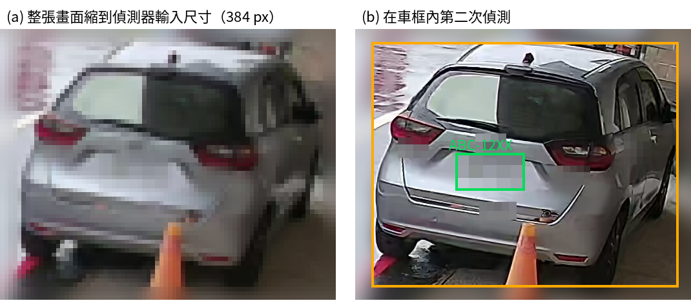
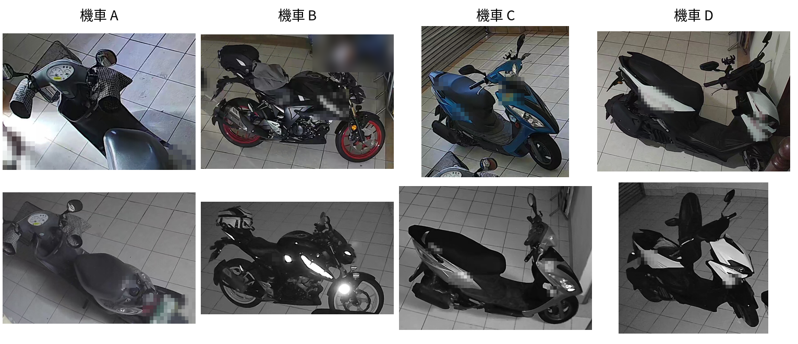
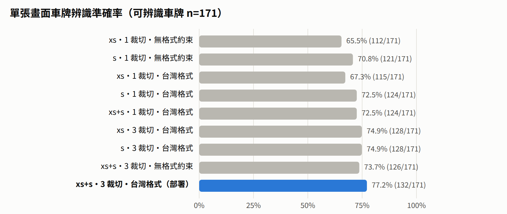
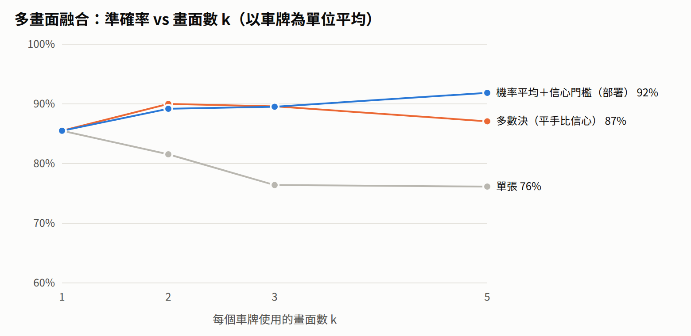
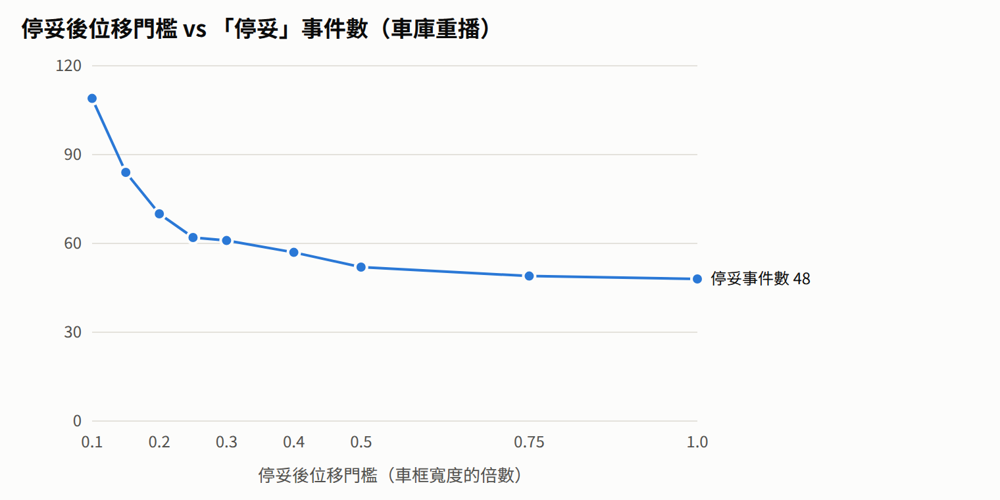
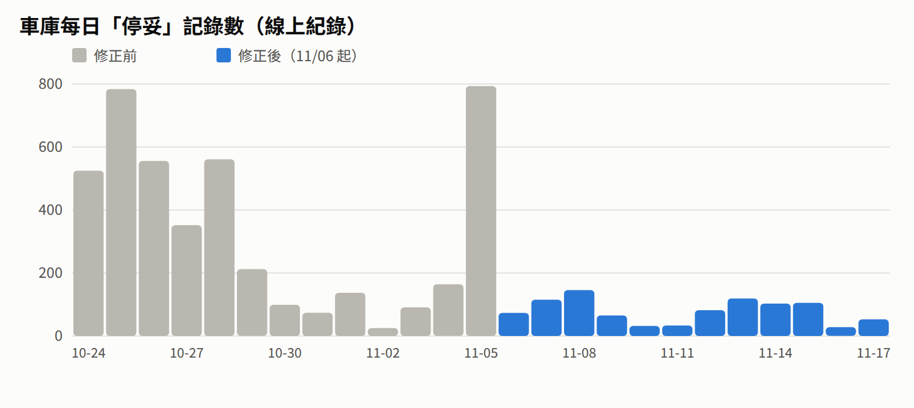
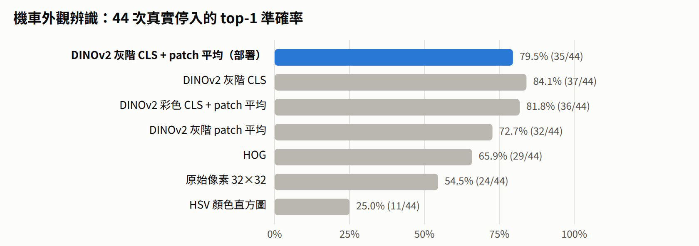

# 僅用 CPU 的住宅車牌辨識與車輛外觀識別系統：多畫面融合、台灣車牌格式約束解碼與自監督特徵比對之實證研究

henry0411 · 2026 年 11 月

---

## 摘要

本文介紹一套實際部署在住家的車牌辨識與車輛識別系統。系統只用一台 4 核心 vCPU、4 GB 記憶體、沒有 GPU 的虛擬機，處理一支戶外旋轉鏡頭與一支車庫內鏡頭。

車牌偵測與 OCR 使用公開的預訓練模型，本文在其上加入幾項處理：車框內的第二次車牌偵測、雙模型與多裁切的機率平均、台灣車牌格式約束解碼、跨畫面機率融合，以及似然式白名單比對。車輛方面則加入已停妥車輛的位移遲滯、停入前後的邊緣相似度驗證，並以 DINOv2 自監督特徵辨識讀不到車牌的自家機車。

評估資料全部來自部署紀錄：350 個車牌偵測結果（其中 171 個可辨識）、379 張機車裁切圖，以及 44 次真實的機車停入。這些資料都由 AI 助理在看不到系統輸出的情況下標註。我們進行消融實驗，並與單一模型、單一步驟的基準比較。主要結果如下（95% 信賴區間）：

**三項主要結果**

- **外觀辨識：** 系統在全部 44 次機車停入中，有 26 次報出車名，**其中 24 次正確（92.3%，[75.9%, 97.9%]）**。在之後才發生的 28 次停入中，報出車名的 14 次全部正確（[78.5%, 100%]），擴增參考圖前後都是如此；擴增 5 張參考圖則讓 **top-1 準確率從 89.3% 提高到 96.4%（27/28，[82.3%, 99.4%]）**。其餘停入只通知「有機車停入」。
- **多畫面融合：** 對同一車牌融合 5 張可辨識畫面，**準確率 91.8%**（13 個車牌，以車牌為單位的 bootstrap 區間 [82.0%, 100%]）。同一組抽樣下，單張為 76.2%，平手比信心的多數決為 87.1%；融合 3 張畫面為 89.5%（25 個車牌）。這只評估解碼正確率，不含確認規則。
- **白名單比對：** **56 個非白名單車牌全部被拒絕（0/56 誤認，誤認率上限 6.4%）**，共 171 次單張測試；白名單中加入一筆只差一位數字的車號時，同樣全部被拒絕。這些測試只用可辨識的車牌，無法辨識的車牌與非車牌沒有測試。白名單車輛的接受率則從逐字比對的 77.2% 提高到 83.6%（以車牌為單位 [73.5%, 93.1%]）。

**其他結果**

- **單張畫面：** 部署組合的準確率為 77.2%（以車牌為單位 [65.0%, 89.3%]），高於任何單一模型、單一裁切的設定（65.5%～72.5%）。
- **車框內第二次偵測：** 可辨識車牌中有 59.6% 只能由這一步找到。
- **停妥遲滯：** 離線重播中，重複的「停妥」事件減少 44%，而且 17 條達到通知條件的軌跡全數保留。

上述車牌結果幾乎都來自戶外白天畫面。樣本量、標註方式與選樣偏差等限制，詳見第 6 節。

**關鍵詞：** 車牌辨識、台灣車牌、多畫面融合、約束解碼、車輛重識別、DINOv2、邊緣運算

---

## 1. 前言

公開的車牌辨識（Automatic License Plate Recognition, ALPR）研究，多半以公路或停車場閘道的高解析度、正面、近距離影像，評估單張畫面的準確率 [7, 8]。住宅場景的條件差很多：

1. **鏡頭不是為車牌設計的。** 家用監視器多為廣角俯拍，車牌在 2K 畫面中常只有 60～120 像素寬，而且常是斜的。
2. **光線變化大。** 夜間紅外線會讓畫面變成灰階，車燈與反光則會造成過曝。
3. **只能用 CPU。** 服務跑在家中的虛擬機上。
4. **問題不只是讀車牌。** 屋主想知道的是「哪一台車停進來了」，但車牌常被擋住或不在畫面中，停進車庫的機車尤其如此。

本文介紹一套在上述條件下運作超過一個月的系統。車牌方面有五項處理，車輛方面有三項，並以真實部署資料評估它們的效果：

- **車牌：** 兩階段車牌偵測、多模型與多裁切平均、格式約束解碼、跨畫面融合，以及似然式白名單比對（§4.1～4.5）。
- **車輛：** 停妥狀態遲滯、邊緣相似度停入驗證，以及以 DINOv2 自監督特徵做小樣本機車辨識（每台 10 張參考圖）（§4.6～4.8）。
- **評估：** 依時間先後切分參考資料與測試資料，並把弱於預期的結果一併報告。

## 2. 相關研究

**車牌偵測與辨識。** 現代 ALPR 通常分兩階段：先用物件偵測器找出車牌，再對裁切出的車牌做 OCR [7, 8]。偵測器多半採用 YOLO 系列 [1, 2]。本系統使用 fast-alpr 套件 [6]，車牌偵測為 YOLOv9-t [1]，輸入 384 像素；OCR 為兩個以 Compact Convolutional Transformer [4] 為骨幹的多國通用車牌模型（cct-xs-v2 與 cct-s-v2），並非台灣專用。這些模型都沒有以台灣資料重新訓練。

**多畫面辨識。** 同一車牌會出現在多張畫面，常見做法是對各畫面的結果投票。本文比較了投票，以及「先平均各字元位置的機率，再解碼」兩種融合方式。

**車輛外觀重識別。** 車輛重識別通常需要大量標註資料，才能訓練度量學習模型。DINOv2 [3] 是自監督學習的視覺特徵，不經微調就能用於檢索。本文把它用在四台車、每台十張參考圖的極小樣本情境，並與 HOG [5] 等傳統特徵比較。

## 3. 系統概觀

| 項目 | 規格 |
|---|---|
| 主機 | QEMU 虛擬機，4 vCPU，4 GB RAM，無 GPU；每次推論限用 1 個 ONNX Runtime 執行緒 |
| 戶外鏡頭 | 2560×1440 旋轉追蹤鏡頭，每秒處理 1 張。只在鏡頭回到原位時判斷停車與紅線臨停（車輛停在禁停紅線旁超過 60 秒即通知），任何角度都會讀車牌 |
| 車庫鏡頭 | 2304×1296，平時每 2 秒處理 1 張，有動靜後 15 秒內提高到每秒 3 張；夜間為紅外線灰階畫面 |
| 車輛偵測 | YOLOv8n（COCO 預訓練 [2, 9]），輸入 640 像素、不外擴；戶外信心門檻 0.2，車庫 0.12 |
| 車牌偵測 / OCR | YOLOv9-t 384 [1] / cct-xs-v2 + cct-s-v2 [4, 6] |
| 外觀特徵 | DINOv2-small [3]（ONNX） |
| 通知 | Synology Chat webhook，附上標註截圖 |

每張畫面的處理流程如下：

1. **品質過濾。** 串流掉資料時會產生大片平坦的灰色區塊，這類 8×8 區塊佔 8% 以上的損壞畫面直接丟棄。畫面幾乎沒有變化（變化像素少於 0.5%）時也略過以節省 CPU，但每 10 秒仍會完整處理一次。
2. **車輛偵測與追蹤。** 以 IoU 配對建立車輛軌跡，並判斷是否停妥（§4.6）。
3. **車牌偵測。** 先偵測整張畫面，再在每個車框內偵測第二次（§4.1）。
4. **車牌追蹤與辨識。** 以中心距離追蹤每個車牌，每秒最多做一次 OCR，並累積機率矩陣（§4.2～4.4）。同一車牌嘗試 20 次仍無法確認時，間隔改為 30 秒。
5. **確認與白名單。** 確認車牌後比對白名單（§4.5），並把車號延續給所屬的車輛軌跡。
6. **讀不到車牌的停入。** 車庫內停妥但讀不到車牌的車，先做停入驗證（§4.7），再做外觀辨識（§4.8），最後發出「某台機車停入」的通知。

*圖 1：(a) 整張畫面縮到偵測器輸入尺寸後，這個車牌只剩約 14 像素寬，偵測不到；(b) 在車框內第二次偵測，以原始解析度找到車牌。車牌與車輛標誌已馬賽克，文字以 ABC-12XX 表示。*

## 4. 方法

### 4.1 兩階段車牌偵測

車牌偵測器的輸入只有 384 像素。2560 像素寬的畫面縮小 6.7 倍後，寬 90 像素的車牌只剩約 13 像素；圖 1 的車牌寬 91 像素，縮小後約 14 像素。這遠低於偵測器能可靠偵測的尺寸。

因此，在整張畫面偵測後，系統把每個車框的每一邊向外擴 10% 裁切，再偵測一次，並把座標換回原圖。兩次結果以中心距離合併：距離小於車牌寬度一半的，視為同一個車牌。車框長寬都超過畫面 60% 時，就跳過第二次偵測。

### 4.2 多模型、多裁切 OCR

每個車牌框以三種外擴比例裁切，括號內依序為水平、垂直外擴比例：(0.05, 0.10)、(0, 0)、(0.12, 0.20)。每個裁切都送進兩個 OCR 模型，取得 10 個字元位置（slot）對 37 個符號（0–9、A–Z、填充符號）的機率矩陣，再把 2 × 3 = 6 個矩陣平均。

### 4.3 台灣車牌格式約束解碼

OCR 預設的解碼方式，是每個位置各取機率最高的符號，可能產生不存在的格式。例如把 ABC-1234 的 A 讀成 8，就會得到 `8BC-1234`。本系統改為列舉台灣的合法格式：

- 汽車：`LLL-DDDD`、`LL-DDDD`、`DDDD-LL`、`DDDD-XX`、`XX-DDDD`
- 機車：`LLL-DDD`、`DDD-LLL`

其中 L 為英文字母（不含 I 與 O），D 為數字，X 為英數皆可但至少含一個字母。

對每種格式，在各位置限定的符號類別中取機率最高者，並要求車牌長度之後的位置都是填充符號，再比較各格式的總對數機率。信心值為全部 10 個位置（含填充位置）的幾何平均機率。

### 4.4 跨畫面機率融合與確認規則

同一車牌在每張畫面都會產生一個機率矩陣。系統把這些矩陣平均後再解碼；單張信心低於 0.45（模糊、被擋住）的畫面不納入。

一般車牌必須同時滿足下列條件才確認：

1. 已累積 *n* 張畫面，戶外 *n* = 3、車庫 *n* = 2；
2. 融合信心 ≥ 0.6；
3. 最近 *n* 次的融合解碼結果一致。

白名單車輛另有一條路徑，見 §4.5。

### 4.5 似然式白名單比對

白名單車輛常在夜間或角度不佳時被讀錯一個字元。系統直接計算白名單上每個車號在融合機率矩陣下的似然 ℓ，也就是該車號各字元（含填充位置）機率的幾何平均。

累積滿 *n* 張畫面後，只要同時滿足 ℓ ≥ 0.85 × c（c 為格式約束解碼的最佳信心）與 ℓ ≥ 0.48，就直接確認為該白名單車輛。這條路徑**不經過** §4.4 的 0.6 信心門檻與一致性檢查。它等於在「最佳解碼」與「白名單假設」之間做似然比檢定，也是兩條確認路徑中把關較寬鬆的一條，所以 §5.6 特別檢驗它的誤認率。

### 4.6 車輛追蹤與停妥遲滯

車輛軌跡以 IoU > 0.3 配對。連續 60 秒偵測不到就視為離開，但 600 秒內又在同一位置（IoU > 0.5）出現的，視為同一台車。車框中心與「靜止基準框」的距離不超過車框寬度的 0.1 倍，並持續一段時間（車庫為 3 秒），就判定為**停妥**。

部署後發現，車庫內的偵測框抖動（尤其是夜間低信心的機車框），會讓根本沒動的車反覆在「移動」與「停妥」之間切換。這也會一再重設停入通知所需的「停妥滿 120 秒」。

因此系統加入**遲滯**：車輛一旦停妥，位移門檻就放寬到車框寬度的 0.3 倍；尚未停妥時仍維持 0.1，以保持駛入時的靈敏度。這個設定只用於車庫鏡頭。戶外的紅線臨停計時使用同一個靜止基準，所以不更動。

### 4.7 停入驗證：停入前後的邊緣相似度

原本就停著的車，可能在被人擋住後重新出現，或因開燈突然被偵測到，因而被誤認為新停入。系統在畫面靜止時，每 30 秒保存一張參考畫面：取灰階影像的對數，計算梯度強度，降採樣後作為邊緣圖。這種表示對光線變化較不敏感。

新車輛停妥滿 120 秒，且已被偵測到至少 5 次後，系統會依序檢查：

1. **停車位冷卻：** 若同一停車位（距離小於畫面寬度的 0.08 倍）在過去 600 秒內仍記錄著停妥的車輛，就不通知。
2. **局部動靜：** 停入前 3 分鐘內必須有局部動靜，排除開燈、日夜切換這類整個畫面一起變化的情況。
3. **邊緣相似度：** 拿車框區域與「首次出現前至少 60 秒」的參考畫面計算正規化互相關。相似度 ≥ 0.5 視為原本就停著，不通知。

### 4.8 機車外觀辨識（DINOv2）

車庫內的自家機車經常拍不到車牌（圖 2）。我們為四台機車（下稱 A～D）各挑選 10 張參考裁切圖，涵蓋白天彩色與夜間紅外線畫面。辨識流程如下：

1. 把裁切圖轉成灰階，補成正方形後縮放到 224×224。
2. 以 DINOv2-small 取出 CLS token（整張影像的嵌入）與各 patch token（局部區域嵌入）的平均，兩者串接並做 L2 正規化。
3. 每台機車的分數，是它與該車所有參考圖的最大餘弦相似度。
4. 最高分 ≥ 0.70 且比第二名高出 ≥ 0.06，才報出車名；否則只通知「有機車停入」。

使用灰階，是為了讓白天與夜間的特徵一致。被認錯的停入裁切圖，只要移到正確車名的資料夾，就會成為新的參考圖，系統會自動重新載入。

*圖 2：機車 A～D 的白天彩色畫面（上排）與夜間紅外線畫面（下排）。車牌、人手、貼紙、品牌字樣與車型貼紙已馬賽克，背景雜物已模糊。*

## 5. 實驗

### 5.1 資料與標註

| 資料集 | 內容 | 標註 |
|---|---|---|
| **P-350**（車牌） | 976 張曾觸發事件的原始畫面，共偵測到 1,338 個車牌框；取偵測信心 ≥ 0.4 的 1,169 個，每組事件最多 6 個，隨機抽出 350 個 | 由 AI 助理逐張判讀，判讀時看不到系統輸出：清楚可讀 124、勉強可讀 47、無法辨識 133、不是車牌 46。前兩類合稱「可辨識」，共 171 個，涵蓋 56 個不同車牌 |
| **M-379**（機車） | 2026/10/23～10/27 的 379 張機車裁切圖 | 同一位標註者分為 A/B/C/D；16 張無法判斷 |
| **ARR-44**（停入） | 2026/10/28～11/17 的全部 44 次機車停入（同期另有 5 次汽車停入，不做外觀辨識） | 同一位標註者標註車輛身分：A 22、B 5、C 11、D 6 |
| **G-replay**（追蹤） | 11 月中旬約 46 小時內，車庫鏡頭有動靜時保存的 1,500 張畫面 | 不需標註，只計數事件 |

外觀參考圖於 10/28 從 M-379 選定，ARR-44 全部發生在選定之後。本文所有標註都由同一位標註者完成，也就是作者使用的 AI 助理，下文簡稱「標註者」。171 個可辨識車牌中，有 165 個來自戶外白天彩色畫面，車庫畫面只有 6 個，其中夜間紅外線只有 1 個。

### 5.2 兩階段偵測

以部署中的車輛偵測設定重跑第二次偵測，171 個可辨識車牌由哪一步找到的分布如下：

| 由哪一步找到 | 數量 | 車牌寬度中位數 |
|---|---|---|
| 只有整張畫面 | 15 | 292 px |
| 兩者都找到 | 51 | 118 px |
| **只有車框內第二次偵測** | **102（59.6%）** | **82 px** |
| 兩者都沒找到 | 3 | 43 px |

*表 1：兩階段偵測的來源。P-350 是以另一組車輛偵測設定（416 像素、外擴 0.15）萃取的，所以有 3 個車牌是部署設定找不到的。*

只靠整張畫面，只能找到 171 個可辨識車牌中的 38.6%；加上第二次偵測，部署設定可找到 168 個（98.2%）。不過，樣本取自系統曾觸發事件的畫面，系統完全沒偵測到的車輛不在其中，所以這兩個比例都會偏高。

### 5.3 單張畫面車牌辨識

| 設定 | 清楚（n=124） | 可辨識（n=171） |
|---|---|---|
| xs・1 裁切・無格式約束 | 72.6% | 65.5% |
| s・1 裁切・無格式約束 | 80.6% | 70.8% |
| xs・1 裁切・台灣格式 | 75.0% | 67.3% |
| s・1 裁切・台灣格式 | 83.1% | 72.5% |
| xs+s・1 裁切・台灣格式 | 82.3% | 72.5% |
| xs・3 裁切・台灣格式 | 84.7% | 74.9% |
| s・3 裁切・台灣格式 | 83.9% | 74.9% |
| xs+s・3 裁切・無格式約束 | 82.3% | 73.7% |
| **xs+s・3 裁切・台灣格式（部署）** | **85.5%**（[78.2%, 90.6%]） | **77.2%**（[70.3%, 82.8%]） |

*表 2：單張畫面車牌辨識的消融實驗。整串車牌完全正確才算正確。*

*圖 3：表 2 中「可辨識」欄的長條圖，藍色為部署設定。*

各項處理的效果：

- **格式約束：** xs 模型 +1.8、s 模型 +1.7、部署組合 +3.5 個百分點。
- **多裁切：** 單項效果最大，xs 模型 +7.6、s 模型 +2.4 個百分點。
- **整體：** 部署組合比最好的單一設定（72.5%）高 4.7 個百分點。

171 個樣本來自 56 個車牌，同一車牌的樣本並不獨立。以車牌為單位做 bootstrap，部署設定的區間為 [65.0%, 89.3%]，比上表的 Wilson 區間寬，個別差異不一定顯著。

依拍攝條件分開看，戶外白天為 131/165（79.4%），車庫只有 1/6 正確。

**錯誤分析。** 部署設定錯了 39 個，其中 21 個屬於勉強可讀，主要有三類：

1. **首字母混淆**，例如 E↔F、B↔S、E↔U。
2. **少讀一位數字。** 一台在車牌旁貼有裝飾貼紙的車被讀成機車的 `LLL-DDD` 格式，同一台車 8 次全錯。這是格式約束把錯誤「合理化」的反例。
3. **斜角下的機車小車牌完全讀錯。**

### 5.4 信心門檻

部署的單張信心門檻 0.45 會從可辨識車牌中排除 7 個，而這 7 個全是讀錯的；保留的 164 個中，132 個正確。但無法辨識的車牌與非車牌中，仍有 53 個信心 ≥ 0.45，所以單張信心不足以排除無效輸入，確認仍需靠 §4.4 的多畫面規則。

若把門檻提高到 0.8，保留的可辨識車牌準確率為 94.9%（129/136，[89.8%, 97.5%]），涵蓋率 79.5%。這個門檻並未部署，也未計算有多少無效輸入會通過。

### 5.5 多畫面融合

對每個至少有 *k* 張可辨識裁切圖的車牌，隨機抽 *k* 張，每個車牌抽 50 次，比較四種做法。所有做法使用同一組抽樣；準確率先在每個車牌內平均，再對車牌平均；信賴區間以車牌為單位做 bootstrap。

| k | 車牌數 | 單張 | 多數決（平手比信心） | 機率平均 | 機率平均＋信心門檻（部署） |
|---|---|---|---|---|---|
| 1 | 56 | 85.5% | 85.5% | 85.5% | 85.5% |
| 2 | 32 | 81.6% | 90.0% | 89.2% | 89.2% |
| 3 | 25 | 76.4% | 89.6% | 89.5% | **89.5%**（[79.4%, 97.3%]） |
| 5 | 13 | 76.2% | 87.1% | 89.7% | **91.8%**（[82.0%, 100%]） |

*表 3：多畫面融合。每列只包含至少有 k 張裁切圖的車牌。出現次數多的車牌，可能多為停放較久、角度較差的車，這或許是單張準確率隨 k 下降的原因。k = 1 列以車牌加權，與表 2 以裁切圖加權的 77.2% 不同。*

*圖 4：表 3 中三種做法的準確率隨畫面數 k 的變化（機率平均未加門檻的結果見表 3）。*

如表 3 與圖 4 所示，融合 3 張以上畫面比單張高 13～16 個百分點（*k* = 3 時 +13.1，*k* = 5 時 +15.6；*k* = 2 時 +7.6）。但機率平均與「平手時比較信心」的多數決差距很小：*k* = 2、3 時兩者相當；*k* = 5 時機率平均高 2.6 個百分點，加上信心門檻後高 4.7 個百分點，而且區間重疊。信心門檻只在 *k* = 5 時多帶來 2.1 個百分點。

這個實驗只評估解碼是否正確，不包含 §4.4 的確認與拒絕規則。另外，若一組畫面全部低於門檻，實驗會改用全部畫面，部署系統則不會。效果可能偏樂觀的另一個原因，見第 6 節第 3 點。

### 5.6 白名單比對

把 56 個可辨識車牌全部放進白名單，評估接受率；再對每個車牌把它自己從白名單移除，評估誤認率。

| 方法 | 白名單車輛被接受 | 非白名單車輛被拒絕 | 白名單中有一位數之差的車號時，被拒絕 |
|---|---|---|---|
| 逐字完全比對 | 132/171 = 77.2% | 171/171 | — |
| **似然式比對（部署）** | **143/171 = 83.6%**（[77.4%, 88.4%]） | **171/171 = 100%** | **171/171 = 100%** |

*表 4：白名單比對（單張畫面）。*

說明：

- **救回的車輛：** 似然式比對多救回 11 台白名單車輛，其中 10 台與最佳解碼只差一個字元。
- **以車牌為單位：** 拒絕結果相當於 0/56 個車牌被誤認，95% 誤認率上限 6.4%。接受率的車牌 bootstrap 區間為 [73.5%, 93.1%]。
- **測試範圍：** 只用可辨識的車牌做單張測試，無法辨識的車牌與非車牌沒有測試，而其中有 53 個能通過 0.45 的單張門檻。
- **相似車號測試的做法：** 把真實車號倒數第二位數字 *d* 改成 (*d* + 5) mod 10，模擬白名單中有一筆打錯一位數的車號。這只測試了數字替換，沒有測試 8/B 這類字母與數字易混淆的組合。

### 5.7 停妥遲滯

**離線重播。** 以部署的車輛偵測器重播 G-replay，並改變停妥後的位移門檻：

| 停妥後門檻 | 停妥事件數 | 單一軌跡最多停妥次數 | 停妥滿 120 秒的軌跡 |
|---|---|---|---|
| 未設（= 0.1） | 109 | 18 | 17 |
| 0.15 | 84 | 11 | 17 |
| 0.2 | 70 | 6 | 17 |
| 0.25 | 62 | 4 | 17 |
| **0.3（部署）** | **61** | **4** | **17** |
| 0.4 | 57 | 3 | 17 |
| 0.5 | 52 | 3 | 17 |
| 0.75 | 49 | 2 | 17 |
| 1.0 | 48 | 2 | 17 |

*表 5：停妥遲滯門檻的消融實驗（車庫重播，各設定均為 47 條軌跡）。*

*圖 5：表 5 的停妥事件數隨門檻的變化。*

已停妥車輛的車框中心與靜止基準框的距離，中位數為車框寬度的 0.018 倍，第 95 百分位為 0.139 倍；有 8.3% 超過原本的 0.1 門檻。部署值 0.3 讓停妥事件減少 44%，17 條達到通知條件的軌跡也全數保留。

不過，重播只檢查軌跡是否達到 120 秒，沒有比較達到的時間點。重播的畫面也只有「有動靜時」保存的畫面，時間間隔與線上不同。

**線上紀錄。** 遲滯在 2026/11/05 晚間上線：

| 期間 | 每日平均停妥記錄 |
|---|---|
| 修正前（10/24～11/05，含上線當天） | 336 筆 |
| 修正前，不含上線當天 | 298 筆 |
| 上線前一週（10/29～11/04） | 115 筆 |
| 修正後（11/06～11/17） | 80 筆 |

減少幅度因比較基準不同，在 31%～76% 之間。這是觀察性比較，各期間的車輛活動量也不同。

*圖 6：車庫每日停妥記錄數，藍色為修正後（11/06 起）。*

### 5.8 停入驗證

10/24～11/18 的線上紀錄中，共有 183 次停入驗證。相似度呈明顯的雙峰分布：56 次低於 0.4、125 次不低於 0.5，介於 0.4 與 0.5 之間的只有 2 次，所以門檻 0.5 落在兩群之間的空隙。部署前的校準中，空位換成新車的相似度為 0.16～0.18。這些驗證沒有逐筆的人工判斷，所以無法計算準確率。

### 5.9 機車外觀辨識

**E1：特徵比較。** 參考圖為 10/28 選定的 40 張，測試集為 ARR-44。top-1 是套用門檻前最相似的那台；使用者實際收到的是「報出車名時的正確率」。

| 特徵 | top-1 準確率 | 報出車名 | 報出車名時的正確率 |
|---|---|---|---|
| **DINOv2 灰階 CLS + patch 平均（部署）** | 35/44 = 79.5% | 26/44 | **24/26 = 92.3%**（[75.9%, 97.9%]） |
| DINOv2 灰階 CLS | 37/44 = 84.1% | 24/44 | 22/24 = 91.7% |
| DINOv2 彩色 CLS + patch 平均 | 36/44 = 81.8% | 29/44 | 26/29 = 89.7% |
| DINOv2 灰階 patch 平均 | 32/44 = 72.7% | 28/44 | 23/28 = 82.1% |
| HOG | 29/44 = 65.9% | — | — |
| 原始像素 32×32 | 24/44 = 54.5% | — | — |
| HSV 顏色直方圖 | 11/44 = 25.0% | — | — |

*表 6：機車外觀辨識的特徵比較（ARR-44）。0.70／0.06 的門檻是為 DINOv2 設定的，不適用於傳統特徵，所以傳統特徵只列 top-1。*

*圖 7：表 6 的 top-1 準確率，藍色為部署設定。*

結果如下：

- **與 HOG 比較：** 部署特徵的 top-1 比 HOG 高 13.6 個百分點，DINOv2 各變形則高 6.8～18.2 個百分點。
- **顏色直方圖：** 幾乎無法使用，因為紅外線讓顏色消失。
- **DINOv2 各變形之間：** 差異都在信賴區間內。部署版的 top-1 比僅用 CLS 低，但報出車名的次數較多（26 對 24），正確率相近。
- **兩次報錯：** 部署設定只報錯兩次，都是機車 C 貼牆側停，被報成 D。D 的參考圖全是貼牆側停的角度，顯示特徵會受停放位置與角度影響。
- **M-379 對照：** M-379 中可用的 363 張有 39 張是參考圖（第 40 張參考圖被標為無法判斷）；在其餘 324 張上，DINOv2 達 98.8%。但這些裁切圖與參考圖來自同幾天、多為連續畫面，屬於樂觀估計。

**E2：參考圖擴增。** 11/05 把五張認錯或無法確定的停入裁切圖加入參考圖。這五張都在 11/06 之前，所以只用 11/06 之後的 28 次停入評估：

| 參考圖 | top-1 準確率 | 報出車名 | 報出車名時的正確率 |
|---|---|---|---|
| 原始 40 張 | 25/28 = 89.3%（[72.8%, 96.3%]） | 14/28 | 14/14 |
| **原始 40 張＋擴增 5 張（部署）** | **27/28 = 96.4%**（[82.3%, 99.4%]） | 14/28 | **14/14 = 100%**（[78.5%, 100%]） |

*表 7：參考圖擴增的效果（11/06 之後的停入）。*

擴增前後報出車名的結果完全相同（14/14），擴增只改變了 top-1；而 top-1 提高的 7.1 個百分點只相當於 2 次停入，區間也重疊。參考圖涵蓋的停放角度是否比特徵選擇更重要，目前仍是待驗證的假設。

## 6. 討論與限制

1. **標註者與樣本量。** 全部標註由同一位標註者完成，沒有標註者間的一致性檢驗。車牌評估只有 171 個可辨識樣本（56 個車牌），外觀辨識依時間切分的測試只有 28～44 次，而且 44 次停入只來自 4 台機車（A 佔 22 次），以單次停入計算的區間偏樂觀。
2. **選樣偏差與適用範圍。**
   - P-350 只取自系統曾觸發事件的畫面，所以召回率會偏高。
   - 133 個無法辨識的車牌不計入準確率。
   - 可辨識車牌幾乎都是戶外白天，夜間與車庫的車牌辨識實際上沒有被評估到。
3. **獨立性。** 多畫面融合實驗用的是同一車牌在不同時間的觀測；部署時融合的是連續畫面，彼此相關性更高，所以實際的融合效果可能比實驗小。
4. **模型未以台灣資料訓練。** 本文的提升來自前處理、解碼與融合。若以台灣資料微調，單張準確率可望明顯提高。
5. **格式約束的副作用。** 同時允許汽車與機車格式時，汽車車牌少讀一位數會被合理化成機車格式（§5.3）。依車輛類別（YOLO 的 car / motorcycle）限定可用格式，是可行的改進方向。
6. **外觀辨識的偏誤。** 特徵受停放位置與角度影響。目前靠擴充參考圖的角度緩解，遮罩背景、只取車體區域是可能的下一步。

## 7. 結論

僅用 CPU 的家用伺服器，以預訓練模型搭配簡單的系統設計，就能做到實用的住宅車牌辨識與車輛識別。主要結果如下：

> **DINOv2 外觀辨識在 44 次真實停入中，報出車名時正確率 92.3%；之後的 28 次停入中報出的 14 個車名全部正確，擴增參考圖後 top-1 準確率達 96.4%。融合 5 張畫面讓車牌解碼準確率從同一批車牌單張的 76.2% 提高到 91.8%（13 個車牌）。似然式白名單比對讓 56 個非白名單車牌全部被拒絕。**

這些數字都附有條件與樣本量，應視為單一住家、單一標註者、以戶外白天為主的初步證據。程式碼與實驗腳本已公開，以便重現與改進。

## 隱私與倫理聲明

鏡頭裝設在自家住宅，戶外鏡頭的畫面包含相鄰的道路。公開的程式碼已移除通知金鑰、內部網路位址、真實白名單與可辨識車型的註解。論文影像只保留裁切後的局部畫面，車牌、品牌與車型標誌、貼紙以及背景雜物都已馬賽克或模糊（圖中沒有人臉入鏡），但車身外形仍可見。文中的車牌一律寫成 ABC-12XX。原始影像與標註包含第三方車牌，因此不公開。

## 參考文獻

1. C.-Y. Wang, I.-H. Yeh, H.-Y. M. Liao. *YOLOv9: Learning What You Want to Learn Using Programmable Gradient Information.* arXiv:2402.13616, 2024.
2. G. Jocher, A. Chaurasia, J. Qiu. *Ultralytics YOLOv8.* https://github.com/ultralytics/ultralytics, 2023.
3. M. Oquab et al. *DINOv2: Learning Robust Visual Features without Supervision.* Transactions on Machine Learning Research, 2024 (arXiv:2304.07193).
4. A. Hassani et al. *Escaping the Big Data Paradigm with Compact Transformers.* arXiv:2104.05704, 2021.
5. N. Dalal, B. Triggs. *Histograms of Oriented Gradients for Human Detection.* CVPR, 2005.
6. ankandrew. *fast-alpr, fast-plate-ocr, open-image-models.* https://github.com/ankandrew, 2024–2026.
7. S. Du, M. Ibrahim, M. Shehata, W. Badawy. *Automatic License Plate Recognition (ALPR): A State-of-the-Art Review.* IEEE Transactions on Circuits and Systems for Video Technology, 23(2), 2013.
8. R. Laroca et al. *A Robust Real-Time Automatic License Plate Recognition Based on the YOLO Detector.* IJCNN, 2018.
9. T.-Y. Lin et al. *Microsoft COCO: Common Objects in Context.* ECCV, 2014.
10. E. B. Wilson. *Probable Inference, the Law of Succession, and Statistical Inference.* Journal of the American Statistical Association, 22(158), 1927.

*除特別註明以車牌為單位的 bootstrap 區間外，本文的 95% 信賴區間均以 Wilson 法 [10] 計算。*
